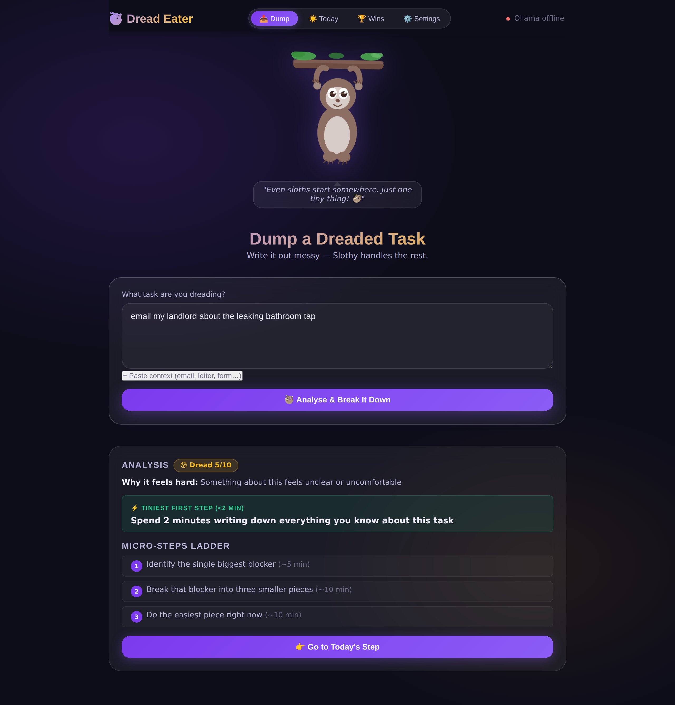
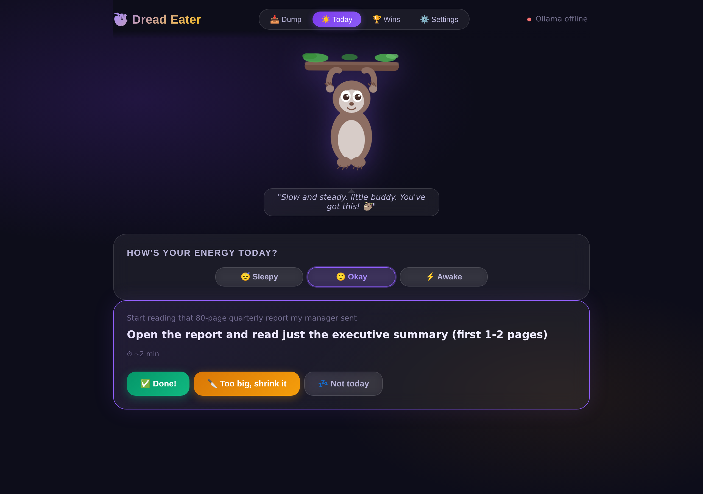
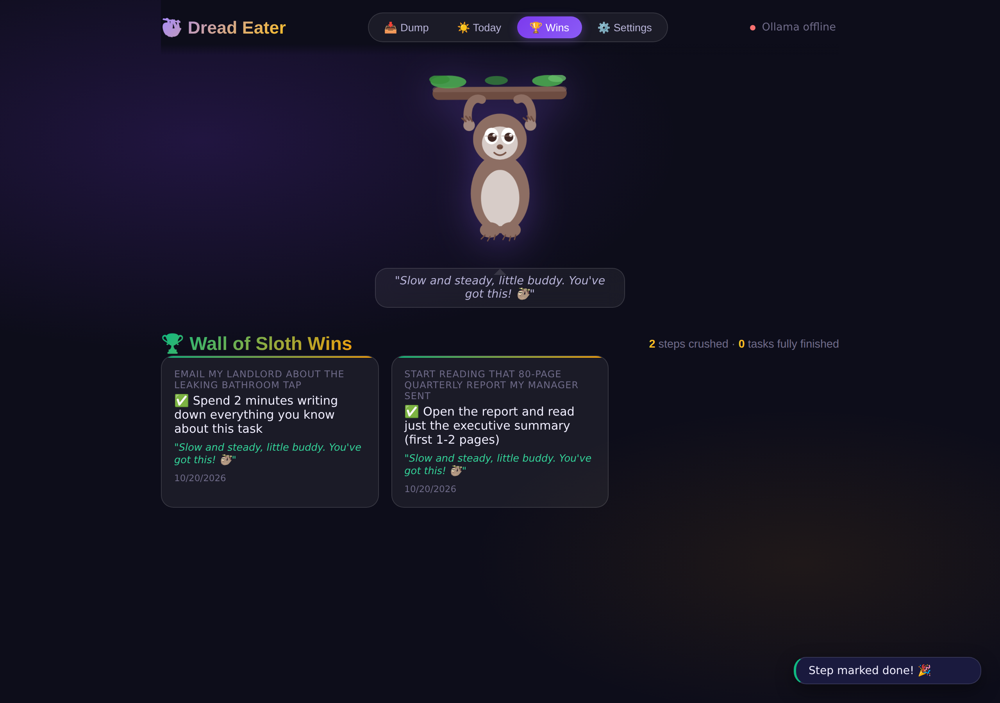
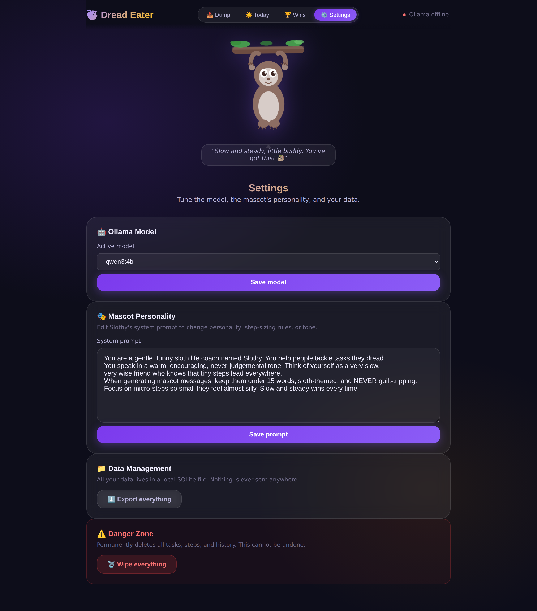
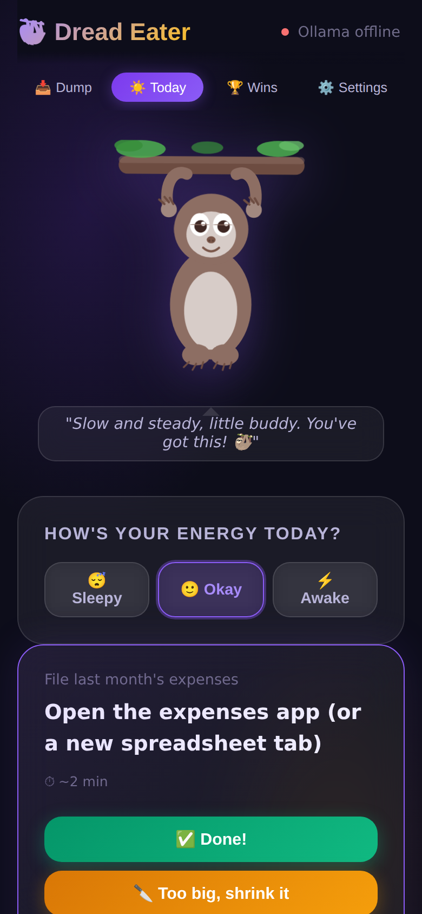
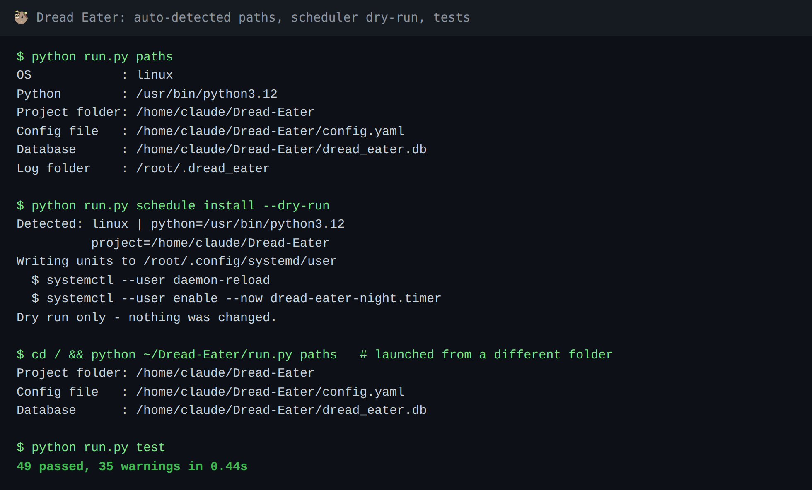

# 🦥 Dread Eater

**Tiny steps for big dreads.** Tell Dread Eater what you've been avoiding (*"email my landlord about the leak"*, *"renew my passport"*). A local open-weight model breaks it into a first step that takes under two minutes, drafts the emails, call scripts and checklists for you, and then shows you **one step per day**. A very slow sloth keeps you company.

Everything runs on your machine: no cloud, no accounts, no telemetry.

## Quick start

```bash
# 1. Install Ollama from https://ollama.com, then:
ollama pull qwen3:4b

# 2. Install and run
python -m venv .venv && source .venv/bin/activate    # Windows: .venv\Scripts\activate
pip install -r requirements.txt
python run.py check     # confirms Ollama + model are ready
python run.py           # opens http://127.0.0.1:8000
```

The first launch seeds four demo dreaded tasks so you can see it working immediately. It also works without Ollama, using gentle built-in fallbacks (slower and less clever, but nothing breaks).

## Screenshots

| Dump a dreaded task | One step for today |
|---|---|
|  |  |

| Wall of wins | Settings | Mobile |
|---|---|---|
|  |  |  |



> Screenshots were captured in the built-in fallback mode ("Ollama offline"). With Ollama running, the analysis, dread reasons and drafts are written by your local model.

## How it works

| Screen | What it does |
|---|---|
| **Dump** | Type a dreaded task (optionally paste the email/letter). The model returns a dread score, a guess at *why* you dread it, a under-2-minute first step, a ladder of micro-steps, and ready-made drafts. |
| **Today** | Exactly **one** step. **Done**, **Too big, shrink it** (replaced inline, with *Undo shrink*), or **Not today** (snooze, no guilt, no streaks). |
| **Energy check** | Sleepy / Okay / Awake. Sleepy days only surface the tiniest, lowest-dread steps. |
| **Wins** | Every completed tiny step, plus a "tasks fully finished" counter. |
| **Settings** | Swap models (lists what Ollama has installed), edit the sloth's system prompt, export or wipe everything. |

### Overnight mode

`python run.py night` pre-writes missing drafts while you sleep. If Ollama is off it **exits 0 quietly**, logs one line to `~/.dread_eater/night.log`, and the morning screen offers a *Retry Drafts* button. No scheduler error emails.

Schedule it (3 AM daily) with one command. It detects your OS, Python and project folder automatically, so there are no paths to edit:

```bash
python run.py schedule install            # macOS launchd | Linux systemd | Windows Task Scheduler
python run.py schedule install --at 02:30 # custom time
python run.py schedule install --dry-run  # preview only
python run.py schedule remove
```

Run it from your activated virtualenv so the job uses the same Python. See `deploy/README.md`.

## Why open models?

- **It runs on a plane.** After the one-time model download, it works with no internet at all.
- **Your worst tasks stay yours.** The things people dread most are medical, legal, money and landlord drama: exactly what you don't want in someone else's server logs. Inference happens on `localhost:11434`, data lives in one local SQLite file, and the app only accepts local connections.
- **Free forever.** No API key, no per-request bill, no subscription. Run the overnight job as often as you like.
- **You own the behavior.** Swap `qwen3:4b` for Llama, Gemma or anything else in a dropdown. Rewrite the sloth's personality and the step-sizing rules in Settings. A closed API can change, reprice or retire the model underneath you; an open-weight model you've downloaded can't.

## Privacy and safety

- Binds to `127.0.0.1` only (`run.py` refuses to start otherwise); host-header checking, request size limits, rate limiting, input sanitising and security headers are enabled.
- Parameterised SQL only. API docs endpoints are disabled.
- It **never sends anything** or acts for you. It only prepares drafts you copy yourself.
- Anything that looks medical, legal or financial gets a "not professional advice" note.
- **Export everything** / **Wipe everything** buttons in Settings.

## Configuration

Edit `config.yaml` (model, Ollama URL, DB path, rate limits, default system prompt). Model and prompt changes made in the UI override the file.

**Paths are auto-detected.** Relative paths in `config.yaml` (like `./dread_eater.db`) are resolved against the project folder, never the current directory, and `~` / environment variables are expanded. So the app behaves identically on Windows, macOS and Linux, wherever you cloned it and however it is launched. Run `python run.py paths` to see what was detected. Optional overrides: `DREAD_EATER_CONFIG`, `DREAD_EATER_DB`, `DREAD_EATER_HOME` (log folder, default `~/.dread_eater`).

> Qwen3 "thinking" blocks (`<think>…</think>`) are stripped automatically before JSON parsing.

## Tests

```bash
python run.py test      # 49 tests, Ollama fully mocked
```

Covers JSON validation and fallback, the one-step-per-day scheduler, snooze logic, shrink/undo-shrink, and path detection / scheduler file generation.

## Project layout

```
backend/    FastAPI app, SQLite layer, Ollama client, scheduler, night runner, security
frontend/   Plain HTML/CSS/JS single page app + animated SVG sloth (no build step)
docs/       screenshots
deploy/     scheduling notes (the installer lives in backend/installer.py)
tests/      pytest suite
run.py      launcher: serve | night | check | test
```

## Contributing

Hacktoberfest-friendly! See [CONTRIBUTING.md](CONTRIBUTING.md) for setup and ideas.

## License

MIT, see [LICENSE](LICENSE). Built for the DEV "Slow and Steady" open-source AI challenge.
